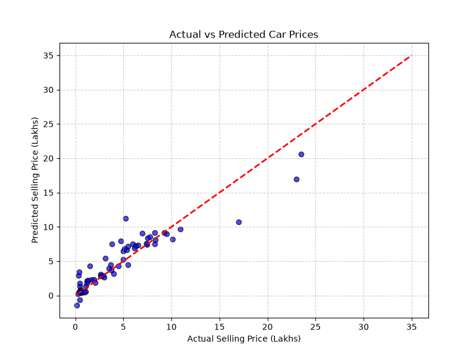

# CodeAlpha_CarPricePrediction

## Project Overview
This project is part of my Data Science Internship at CodeAlpha. It builds a Machine Learning regression model to predict the selling prices of used cars based on features like present price, driven kilometers, fuel type, transmission, and car age.

## Technologies Used
* Python[cite: 1]
* Pandas & NumPy
* Scikit-learn[cite: 1]
* Matplotlib[cite: 1]

## Model Performance
* **R2 Score**: ~0.85+
* **RMSE**: Evaluated on test split.

## Visualization

